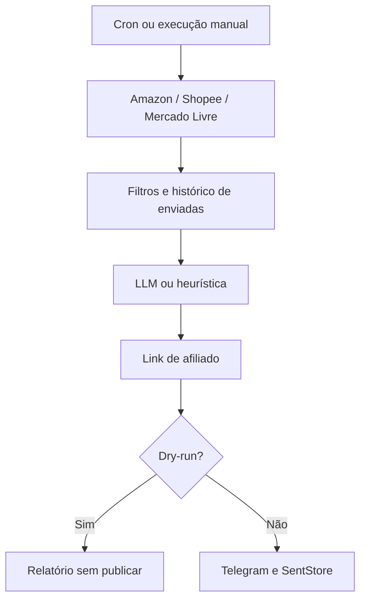

# Agente de promoções

## Fluxo

Jobs com cron → busca por palavra-chave e loja → filtros → deduplicação → curadoria → link de afiliado → Telegram.
Polling legado e API de publicação continuam independentes do agendamento.



Falha em uma busca → erro no relatório; demais buscas continuam.
LLM recebe até 25 candidatas, previamente ordenadas pela heurística.
Dry-run consulta lojas e pode consumir tokens; não publica nem registra novas enviadas.

## Configuração passo a passo

1. Instalar com Node.js 22.9+ → `npm install`.
2. Criar arquivos locais:

   ```bash
   cp .env.example .env
   cp agent.config.example.json agent.config.json
   ```

3. Editar `affiliates.amazon.tag` com sua tag real. Exemplo inclui Amazon e Shopee; Mercado Livre não participa dos jobs.
4. Preencher `.env`: `OPENROUTER_API_KEY`, `SHOPEE_APP_ID`, `SHOPEE_SECRET`. Sem acesso à Shopee → remover `shopee` de todos os arrays `sources`.
5. Para publicar → preencher `TELEGRAM_TOKEN` e `GROUP_ID`; adicionar bot ao grupo, conceder permissão para enviar mensagens. Canal → bot administrador.
6. Preencher `ADMIN_IDS` com IDs de **usuários**, separados por vírgula. Não usar ID do grupo. Vazio → comandos administrativos desabilitados.
7. Validar e simular:

   ```bash
   npm run agent -- --list
   npm run agent -- eletronicos-hora-em-hora --dry-run
   ```

8. Conferir títulos, preços e links → `npm run dev`.
9. Produção → `npm run build && npm start`. Manter processo ativo para executar cron.

`AGENT_CONFIG` aponta para `./agent.config.json` por padrão. Arquivo ausente → agente desligado, log informativo. Arquivo existente inválido → inicialização falha; não é ignorado silenciosamente.
Reiniciar processo após alterar configuração. Não versionar `.env`, `agent.config.json` ou `data/`.

## Referência completa de configuração

Schema: `src/agent/config.ts`. Objetos são estritos: campos desconhecidos são rejeitados. JSON não aceita comentários.
“Obrigatório” significa ausência sem valor padrão; “opcional” significa campo ausente permitido.

### Raiz e objetos aninhados

| Campo | Tipo | Padrão | Descrição |
|---|---|---|---|
| `timezone` | string | `America/Sao_Paulo` | Fuso usado pelo cron, preferencialmente identificador IANA. |
| `llm` | objeto | ausente | Sem bloco → heurística. |
| `llm.provider` | enum | obrigatório no bloco | `openrouter`, `openai` ou `anthropic`. |
| `llm.model` | string não vazia | obrigatório no bloco | ID enviado ao provedor; schema não verifica catálogo ou acesso. |
| `affiliates` | objeto | `{}` | Configuração de links por loja. |
| `affiliates.amazon` | objeto | ausente | Obrigatório quando qualquer job usa Amazon. |
| `affiliates.amazon.tag` | string não vazia | obrigatório no bloco | Tag do Amazon Associados. |
| `affiliates.mercadolivre` | objeto | ausente | Obrigatório quando qualquer job usa Mercado Livre. |
| `affiliates.mercadolivre.params` | objeto string → string | obrigatório no bloco | Parâmetros acrescentados à URL; exemplo `{"matt_tool":"SEU_ID"}`. Usar valores do seu programa. |
| `affiliates.shopee` | objeto vazio | ausente | Apenas `{}`; não aceita `enabled`. Link vem da API. |
| `repostAfterDays` | número ≥ 0 | `7` | TTL do histórico, em dias; aceita frações. `0` desativa expiração temporal, não libera repostagem imediata. |
| `delayBetweenPostsSeconds` | número ≥ 0 | `3` | Pausa entre publicações no mesmo job; não controla intervalo de buscas. |
| `jobs` | array de objetos | `[]` | Jobs configurados; vazio → nenhuma tarefa agendada. |

### Cada item de `jobs`

| Campo | Tipo | Padrão | Descrição |
|---|---|---|---|
| `name` | string | obrigatório | Único; letras, números, `-`, `_`; primeiro caractere alfanumérico. |
| `schedule` | string não vazia | obrigatório | Expressão cron validada com Croner e fuso configurado. |
| `keywords` | array de strings não vazias | obrigatório | Pelo menos uma palavra-chave. |
| `sources` | array de enums | `["amazon","shopee"]` | Pelo menos uma fonte: `amazon`, `shopee`, `mercadolivre`. |
| `maxPosts` | inteiro 1–20 | `3` | Máximo de escolhas; não garante esse número de publicações. |
| `perKeyword` | inteiro 1–50 | `15` | Limite solicitado por palavra-chave **por fonte**; não é número de páginas. |
| `minDiscount` | número 0–95 | `10` | Desconto mínimo percentual, arredondado para inteiro. Sem preço original válido → desconto 0. |
| `minRating` | número 0–5 | ausente | Filtra notas conhecidas inferiores ao mínimo; ofertas sem nota continuam elegíveis. |
| `minPrice` | número ≥ 0 | ausente | Preço mínimo inclusivo, em reais. |
| `maxPrice` | número > 0 | ausente | Preço máximo inclusivo, em reais; deve ser ≥ `minPrice`. |
| `exclude` | array de strings | `[]` | Exclui título contendo termo, ignorando caixa e acentos. Evitar string vazia: excluiria tudo. |
| `instructions` | string | ausente | Instruções adicionais para LLM; heurística não interpreta este campo. |
| `chatId` | string ou número | ausente | Destino específico do job; convertido para string. Ausente → destino padrão do publisher (`GROUP_ID`). |
| `useLlm` | boolean | `true` | Usa LLM se configurado; `false` força heurística. |
| `enabled` | boolean | `true` | Habilita cron; `false` não impede execução manual. |

Credenciais são verificadas também para jobs desabilitados. Bloco `llm` presente exige sua chave mesmo que todos os jobs tenham `useLlm: false`.
Erros estruturais são listados juntos; após schema válido, validação reúne erros de credenciais, nomes duplicados, cron e faixa de preço.

## Cron e fuso horário

Formato usado nos exemplos → `minuto hora dia-do-mês mês dia-da-semana`.

| Frequência | Expressão |
|---|---|
| De hora em hora, minuto zero | `0 * * * *` |
| A cada 30 minutos | `*/30 * * * *` |
| Dias úteis às 9h | `0 9 * * 1-5` |
| Todos os dias às 9h | `0 9 * * *` |
| Sábado e domingo às 10h e 16h | `0 10,16 * * 6,0` |

Domingo → `0`; sábado → `6`. Horários seguem `timezone`, não o fuso do servidor.
`America/Sao_Paulo` mantém intenção de horário local conforme regras do fuso.
`/jobs` mostra próxima execução nesse fuso; datas JSON devem ser interpretadas como instantes, não horários locais sem fuso.
Scheduler impede sobreposição do mesmo job no processo; jobs diferentes podem coincidir. Job desabilitado não possui próxima execução agendada.

## LLM: chave, modelo e custo

Criar conta no provedor → habilitar faturamento/créditos → gerar chave → salvar somente no `.env`.

| `llm.provider` | Variável | Onde obter chave | Exemplos de `llm.model` |
|---|---|---|---|
| `openrouter` | `OPENROUTER_API_KEY` | [OpenRouter Keys](https://openrouter.ai/settings/keys) | `anthropic/claude-haiku-5.5`, `deepseek/deepseek-v4.1-flash`, `google/gemini-3.8-flash` |
| `openai` | `OPENAI_API_KEY` | [OpenAI API Keys](https://platform.openai.com/api-keys) | `gpt-6-luna` |
| `anthropic` | `ANTHROPIC_API_KEY` | [Anthropic Console](https://console.anthropic.com/) → API Keys | `claude-haiku-5-5` |

OpenAI e OpenRouter → Chat Completions; Anthropic → Messages. Cliente usa timeout de 90 segundos e limite padrão de saída de 1.500 tokens. Esses valores não são opções do JSON.
Conferir disponibilidade e compatibilidade na conta antes de usar; validação local não faz chamada ao provedor. Referência: [documentação oficial OpenAI — GPT-6 Luna](https://developers.openai.com/api/docs/models/gpt-6-luna).

Exemplo de troca do bloco:

```json
"llm": { "provider": "openai", "model": "gpt-6-luna" }
```

### Estimativa por execução

Prompt com aproximadamente 25 ofertas → 3–4 mil tokens de entrada e aproximadamente 300 de saída.
Referência Haiku 5.5 → US$0,10/milhão de entrada e US$0,50/milhão de saída, conforme [anúncio da Anthropic](https://www.anthropic.com/claude-haiku-5-5).

- 3.500 × US$0,10 / 1.000.000 + 300 × US$0,50 / 1.000.000 → **US$0,0005 por execução**.
- 24 execuções/dia × 30 dias × US$0,0005 → **US$0,36/mês por job de hora em hora**.

Estimativa, não orçamento garantido. Quantidade de candidatas, tamanho das instruções, saída, tarifas do provedor e execuções manuais alteram custo. Não inclui hospedagem, impostos ou câmbio. Sem candidatas → sem chamada LLM. Dry-run também pode gerar cobrança.

### Sem LLM

Definir `useLlm: false` no job ou remover bloco `llm` da raiz.
Para dispensar chave completamente → remover bloco `llm`.
Heurística ordena por desconto, nota e popularidade (avaliações + vendas), selecionando até `maxPosts`. Não gera chamada editorial e não segue `instructions`.
Falha de chamada ou parsing do LLM → aviso no log e heurística. Resposta válida com lista vazia → nenhuma publicação, sem fallback.

## Lojas e afiliados

### Amazon

- Criar conta no [Amazon Associados](https://associados.amazon.com.br/) → obter tag → preencher `affiliates.amazon.tag`.
- Implementação atual lê HTML da busca pública, ignora patrocinados identificados e extrai preço, preço original, nota e imagem quando disponíveis.
- Link canônico `/dp/ASIN` recebe parâmetro `tag`.
- Intervalo mínimo padrão entre buscas sequenciais → **3 segundos**; não confundir com `delayBetweenPostsSeconds`.
- Acordo de Associados restringe coleta automatizada do site. Uso por conta e risco; intervalo não representa autorização. Ideal → migrar para PA-API, não implementada aqui.
- Planejar elegibilidade com 3 vendas qualificadas em 180 dias e aprovação da conta; confirmar regras vigentes no painel. Consultar [requisitos oficiais da API](https://associados.amazon.com.br/help/node/topic/GVJ2BJP35457CLML) e contrato antes de operar.

### Shopee

- Acessar [painel de afiliados Shopee](https://affiliate.shopee.com.br/) → solicitar/habilitar **Shopee Affiliate Open API** → obter App ID e Secret.
- Configurar `SHOPEE_APP_ID` e `SHOPEE_SECRET`. Cadastro como afiliado não garante acesso à Open API.
- Busca GraphQL `productOfferV2`, primeira página, ordenação por mais vendidos; assinatura SHA256 de App ID, timestamp, payload e secret.
- `offerLink` já vem com identificação do afiliado. Não acrescentar tag Amazon nem inventar parâmetros.
- `affiliates.shopee: {}` é aceito, mas não substitui credenciais. Produtos sem link de afiliado são descartados.

### Mercado Livre — experimental

- Criar aplicação para obter `ML_CLIENT_ID` e `ML_CLIENT_SECRET`; obter parâmetros reais no Programa de Afiliados e preencher `affiliates.mercadolivre.params`.
- Implementação tenta OAuth `client_credentials` e busca oficial `/sites/MLB/search`.
- Integração registra restrições de busca desde 2025: pode responder **403**, inclusive com token válido. Credenciais não garantem autorização.
- Scraping pode ser bloqueado por verificação de conta; não existe fallback de scraping neste projeto.
- `{"matt_tool":"SEU_ID"}` é placeholder; não garante atribuição de comissão. Usar parâmetros fornecidos pelo programa.
- Não habilitado nos jobs do exemplo. Confirmar acesso antes de adicionar `mercadolivre` em `sources`.

## Histórico, deduplicação e repostagem

Contrato de integração → mesmo `SentStore` compartilhado por agente, poller legado e API; arquivo `DATA_DIR/sent.json`, diretório padrão `./data`.
TTL → `repostAfterDays × 86400000` milissegundos. `0` → sem expiração por tempo.

- Agente → chave `loja:id|preço` com duas casas decimais.
- Mesmo produto no mesmo preço → bloqueado até expirar.
- Preço diferente, inclusive aumento → chave nova; filtros ainda se aplicam.
- Mesma execução → deduplica por loja + ID e conserva menor preço.
- Poller/API → chave própria baseada em URL e preço; compartilhar armazenamento não unifica chaves de origens diferentes.
- Histórico não é separado por chat; publicação em um destino pode impedir repetição em outro.
- Registro após publicação bem-sucedida; dry-run não adiciona entradas.
- Limite padrão → 5.000 entradas; remoção de antigas pode permitir repostagem antes do TTL.
- Arquivo salvo via temporário e rename; leitura inválida gera aviso e inicia histórico vazio.

Preservar `data/` em volume persistente e garantir permissão de escrita. Arquivo não é banco multi-processo: evitar várias instâncias gravando nele.

## Comandos do Telegram

| Comando | Acesso | Resultado |
|---|---|---|
| `/start` | todos | Ajuda inicial. |
| `/help` | todos | Lista de comandos. |
| `/chatid` | todos | ID do chat atual; não é necessariamente ID do usuário. |
| `/jobs` | `ADMIN_IDS` | Nome, cron, palavras-chave e próxima execução no fuso configurado. |
| `/rodar <job>` | `ADMIN_IDS` | Executa e publica agora. |
| `/testar <job>` | `ADMIN_IDS` | Responde ao admin escolhas com título, preço, desconto, loja e link de afiliado; não publica. |

## HTTP

`API_KEY` definida → enviar `x-api-key` em `/promo` e `/jobs`. Ausente → endpoints sem autenticação por chave; não expor publicamente sem proteção. `/health` é público.

| Método | Rota | Resultado |
|---|---|---|
| `GET` | `/health` | Estado do serviço. |
| `POST` | `/promo` | Publicação avulsa; formato no README. |
| `GET` | `/jobs` | Lista JSON do scheduler: nome, schedule, keywords, enabled, running, nextRun e lastReport quando houver. |
| `POST` | `/jobs/:name/run?dryRun=true` | Simula job e retorna relatório. |
| `POST` | `/jobs/:name/run?dryRun=false` | Executa e publica; retorna relatório. |

```bash
curl http://localhost:3000/jobs -H "x-api-key: $API_KEY"
curl -X POST 'http://localhost:3000/jobs/eletronicos-hora-em-hora/run?dryRun=true' \
  -H "x-api-key: $API_KEY"
```

Execução → `200` relatório; `404` job inexistente; `409` já rodando; `503` agente desligado; `401` chave ausente/inválida quando exigida.
Relatório: `job`, `startedAt`, `durationMs`, `found`, `candidates`, `published`, `failed`, `errors`, `dryRun`. Em simulação, `published` representa escolhas, não envios reais. `200` não garante que todas as buscas ou publicações tiveram sucesso; conferir `errors` e `failed`.

## CLI

```bash
npm run agent -- --list
npm run agent -- eletronicos-hora-em-hora --dry-run
npm run agent -- eletronicos-hora-em-hora
```

Script contratado → `tsx --env-file-if-exists=.env src/cli/runJob.ts`.
Executa uma vez, imprime `summarizeReport` e escolhas. Não mantém cron ativo.
`--dry-run` usa publisher nulo: não exige `TELEGRAM_TOKEN` ou `GROUP_ID`; exige credenciais das fontes e do LLM configurados.

## Boas práticas

- Começar com `maxPosts: 1` ou `3`, poucos termos e baixa frequência.
- Não exagerar em execuções manuais: também consultam lojas e consomem tokens.
- Distribuir jobs ao longo do dia; evitar cron coincidente.
- Testar links e atribuição de afiliado antes de publicar.
- Informar grupo sobre links de afiliado; respeitar políticas das lojas e do Telegram.
- Usar `minDiscount`, limites de preço e `exclude`; desconto anunciado não prova menor preço histórico.
- Proteger `.env`, histórico e API; não compartilhar chaves em logs.

## Troubleshooting

| Sintoma | Diagnóstico → ação |
|---|---|
| Amazon pede captcha | Muitas requisições, IP bloqueado ou mudança na página → reduzir frequência, suspender fonte e avaliar API autorizada; não tentar contornar captcha. |
| Amazon retorna zero ofertas | HTML alterado, patrocinados descartados ou filtros restritivos → conferir busca e relatório; revisar parser fora da configuração. |
| Shopee erro `10035` | Conta sem acesso à Open API → solicitar habilitação no painel; conferir App ID/Secret. |
| Mercado Livre `403` | Restrição do endpoint/aplicação → confirmar permissões no painel; desabilitar fonte enquanto sem acesso. |
| LLM falha | Chave, saldo, modelo, timeout ou JSON inválido → conferir log do curador; execução cai na heurística. |
| Configuração inválida | Validador lista erros da etapa → corrigir campos, credenciais, cron, nomes e faixas; executar `npm run agent -- --list` novamente. |
| Agente desligado / HTTP `503` | Arquivo ausente → conferir `AGENT_CONFIG` e diretório de execução; copiar exemplo. |
| Nenhuma candidata | Desconto inexistente vira 0, preço fora da faixa, exclusão, link ausente ou histórico → conferir filtros e TTL. |
| Admin não responde | `ADMIN_IDS` vazio ou usuário não autorizado → usar ID do usuário, não do grupo. |
| Telegram recusa envio | Token, destino ou permissões → conferir `GROUP_ID`, `chatId` e acesso do bot. |
| HTTP `409` ao executar job | Mesmo job em andamento → aguardar; não iniciar outra instância para contornar bloqueio. |
| Histórico reinicia vazio | Arquivo inválido, volume efêmero ou caminho errado → conferir log `[sent]`, `DATA_DIR`, permissões e backup. |
